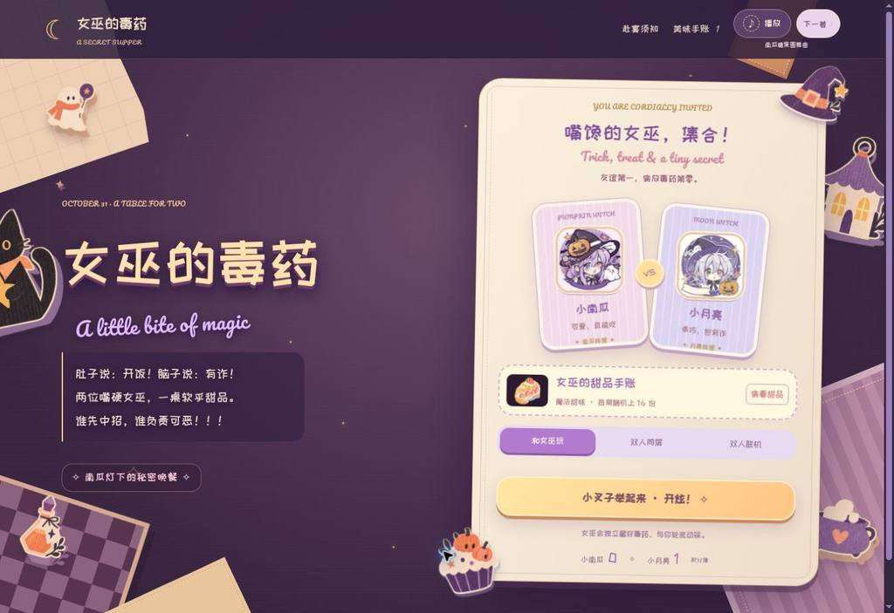
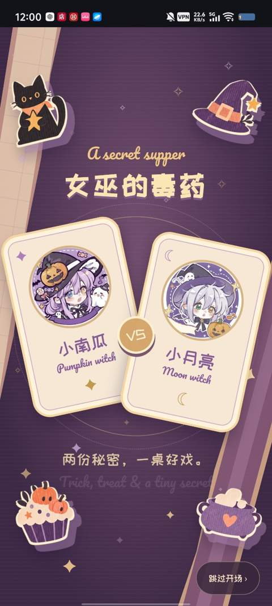
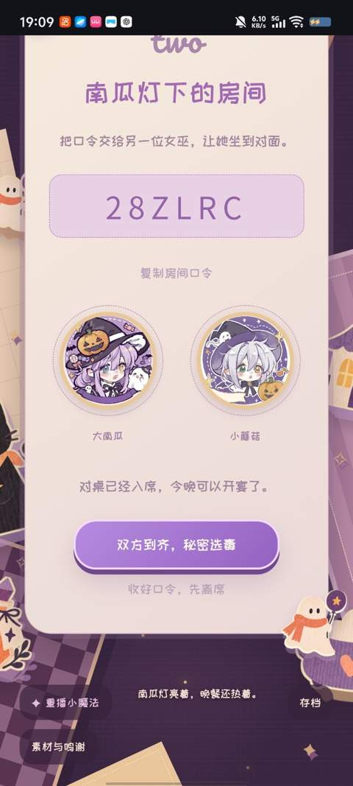
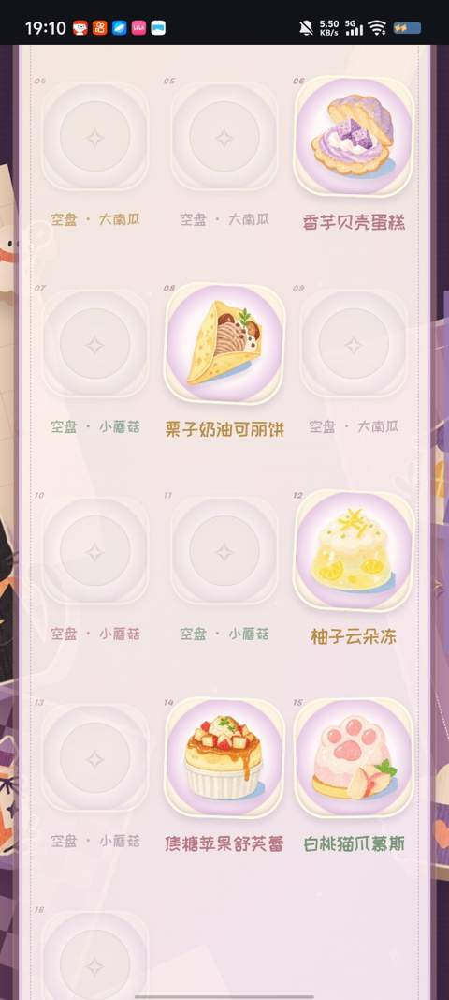
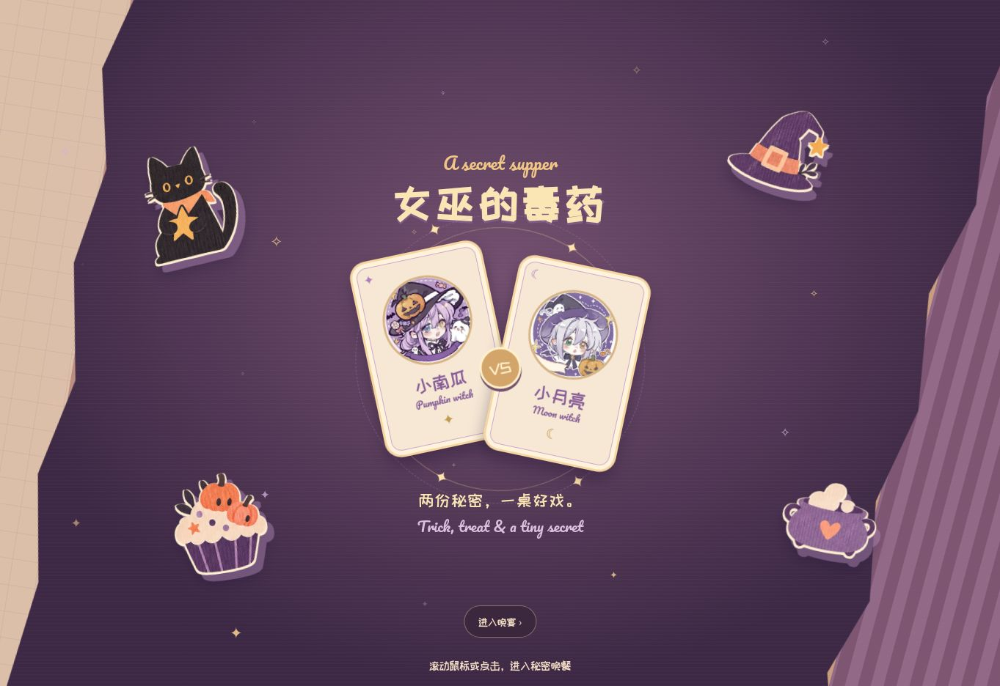

# 女巫的毒药

南瓜灯下的晚餐 · A Secret Supper

作者：**Velunelle** · 仓库：**velunelle/witches-banquet**

两位女巫，一桌甜品，各藏一道毒药。轮流动筷，先中招的人离席。

[立即试玩](https://witches-banquet.fuzzy-egret-1442.chatgpt.site/) · [反馈问题](https://github.com/velunelle/witches-banquet/issues/new/choose) · [参与修改](CONTRIBUTING.md) · [素材与许可](ASSETS.md)

手机和电脑均可通过浏览器游玩，无需注册或配置 API。当前版本 **v1.0.0**，提供人机、双人同屏和房间码联机。



## 演示视频与手机实拍

[观看演示视频（74 秒，MP4）](docs/demo.mp4)

视频和下面三张手机截图由项目发起者提供。截图中的自定义昵称、房间口令及界面文字属于录制当时的状态。

| 开场 | 双人房间 | 游玩过程 |
| --- | --- | --- |
|  |  |  |

## 怎么玩

1. 每局从 32 份水彩甜品中随机上桌 16 份。
2. 双方各自秘密指定一道毒药，可以选同一道。
3. 轮流取食；每道甜品可从三句口味感受中选一句，听角色点评。
4. 吃到任意一方设下的毒药就输，胜者积 1 分，下一局轮换先手。

| 模式 | 需要什么 | 如何开始 |
| --- | --- | --- |
| 和女巫玩 | 一人、一台设备 | 女巫独立选毒，取食时不知道你的秘密。 |
| 双人同屏 | 两人、一台设备 | 按遮屏提示交接设备，各自选毒。 |
| 双人联机 | 两人、各一台设备、网络连接 | 一人建房，另一人输入六码口令加入。 |

## 这场晚餐里有什么

水彩甜品、万圣节贴纸、双人翻牌请柬和纸片过渡组成整场晚餐。两首合成背景音乐可切换，音乐可以暂停；品尝记录进入“美味手账”，积分簿记录各模式成绩。

本地对局支持自动保存、三槽手动存档和 JSON 导入／导出。记录属于当前浏览器；更换浏览器或网址不会自动迁移，请先导出备份。联机对局不能通过本地存档回退。

<details>
<summary>查看开场请柬</summary>



</details>

## 运行与修改

只想玩，直接打开上方试玩链接。想自行部署，发布仓库中 **dist/ 里面的全部内容**，保留 assets、opening、vendor 等目录，使用 HTTPS。运行已构建的网站无需安装 Node.js。

从源码重建需要 Node.js 22 或更新版本，以及 npm：

```sh
git clone https://github.com/velunelle/witches-banquet.git
cd witches-banquet
npm ci
npm test
npm run build
npm run check
npm run check:assets
python3 -m http.server 8000 --directory dist
```

打开 http://localhost:8000 。最后一条本地预览命令需要 Python 3，也可以换成自己的静态服务器。安装依赖需要访问 npm 软件源。

`npm run build` 同时生成多文件网站和 `release/witches-banquet-standalone.html`。后者内嵌图片、字体、脚本和样式，适合备份；安卓／iOS 文件预览器和本地 `file://` 的完整兼容仍待真机复验。联机模式始终需要网络，优先使用 HTTPS 试玩。

### 源码从哪里看

| 想修改什么 | 入口 |
| --- | --- |
| 胜负、回合与状态 | `src/core/engine.js`、`src/core/state.js` |
| 存档和导入校验 | `src/core/persistence.js`、`src/features/saves.js` |
| 房间连接、消息与恢复 | `src/features/network.js`、`src/core/protocol.js`、`src/core/reliable-link.js` |
| 甜品、口味与点评 | `src/data/menu.js` |
| 页面、动效和样式 | `src/ui/`、`src/styles/`、`src/opening/` |
| 音乐和音效 | `src/audio/` |
| 图片、字体和第三方库 | `public/assets/`、`public/vendor/` |

开发时修改 src 和 public，再构建 dist；不要只修改构建产物。更多托管步骤见 [部署指南](DEPLOYMENT.md)。

## 验证与已知限制

本次发布已通过 29 项自动测试、源码与样式检查、ESLint 零错误／零警告及资源完整性检查。测试覆盖规则、存档校验、重复操作、联机消息与断线重放等；这不等于所有手机和网络都测试过。项目发起者与朋友已完成真实双人连接及游玩测试。

- 联机使用 PeerJS / WebRTC，部分网络无法直连，目前不保证所有网络都能建立房间连接。
- 短时断线会在 90 秒内尝试恢复；须保留原页面，刷新、关闭或系统回收后无法恢复房间。
- 安卓 Chrome、iOS Safari 的完整兼容矩阵及更多设备上的加载表现仍待补充。
- 正式试玩站已公开运行；GitHub Pages 是尚未启用的备用部署方式。

[测试记录](docs/TEST-REPORT.md) · [版本变化](CHANGELOG.md) · [自动检查记录](https://github.com/velunelle/witches-banquet/actions/workflows/ci.yml)

## 创作与鸣谢

项目由发起者确定玩法取舍、视觉方向与验收要求，开发过程中使用 AI 辅助编写和修改代码。32 份水彩甜品和 16 份万圣节贴纸由本项目使用 AI 制作；角色头像为小红书博主 **野莓甜心**老师的 AI 创作，保留作者署名。

开屏翻牌参考 47、nival、baink 的 [BETWEEN US](https://github.com/knacl47/between-us)，动作节奏参考 [qimingjiu/Trianon](https://github.com/qimingjiu/Trianon)。字体使用站酷快乐体与 Pacifico，联机使用 PeerJS；第三方代码与字体许可均保留在仓库中，详见 [ASSETS.md](ASSETS.md)。

## 许可状态

原创代码与本项目编写的文档采用 **MIT**，见 [LICENSE](LICENSE)。允许在保留版权与许可声明的条件下使用、修改、分发及商用代码。引用的第三方代码保留其原版权和许可证，不将其署名改成本项目作者。

**MIT 不覆盖图片、角色头像、截图中的素材或字体。** 角色头像作者为野莓甜心；用户提供的作者规则允许保存、自裁、头像和壁纸用途，同时禁止商用、倒卖、临摹、搬运、二创等。这份规则没有明确说明允许将头像原文件随公开仓库分发，因此不能把它表述为已获得该项授权，也不向下游授予头像复用权。本项目有权授权的 32 份 AI 水彩甜品与 16 份万圣节贴纸采用 CC BY 4.0，署名 Velunelle，允许修改、传播及商用，须注明来源、许可证及修改情况；字体和第三方库分别遵循原许可。

详细来源、授权范围与仍需确认的头像分发事项见 [ASSETS.md](ASSETS.md) 和 [许可说明](docs/LICENSING.md)。

## English

**A Secret Supper** is a Halloween dessert game for browsers. Each player secretly marks one poisoned dessert. Take turns tasting; whoever eats either poisoned dessert loses. Each round serves 16 of 32 illustrated desserts.

[Play in your browser](https://witches-banquet.fuzzy-egret-1442.chatgpt.site/). Supports a computer opponent, two players on one device, and two-device online rooms. No account or model API is required. The interface is currently in Chinese. Online play uses PeerJS / WebRTC; connectivity depends on the network.

Build with `npm ci && npm run build`; serve all files inside dist over HTTPS. Original code and project-authored documentation are MIT-licensed (Velunelle); retain third-party notices. The 32 project-generated dessert images and 16 journal stickers are licensed under CC BY 4.0 to the extent the project can grant rights: credit Velunelle, link the source and license, and indicate changes. Images, character portraits, fonts and third-party libraries have separate terms; see [ASSETS.md](ASSETS.md).
